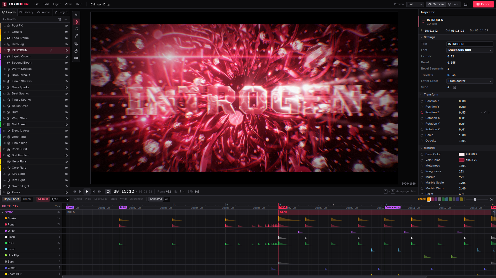

<p align="center"></p>
<h1 align="center">Introgen</h1>
<p align="center">A small studio for those 2015 3D sync intros, in the browser.</p>



Making one of these used to mean Cinema 4D, After Effects, Element 3D, Optical Flares, Particular,
RSMB, and a night of rendering, all to use perhaps 5% of what those tools can do. Introgen is that 5%:
a real timeline, keyframes and camera, with the rest of the software removed.

```sh
pnpm install
pnpm dev        # http://127.0.0.1:5173, opens with the demo intro loaded
```

Press **Space**. `docs/demo-intro.mp4` is the demo, exported by the app itself.

## What replaced what

| Then | Now |
| --- | --- |
| C4D MoText + effectors | **3D Text** with a per-letter animator: reveal, stagger, flip wave, jitter |
| C4D camera + target null | **Camera** orbit rig. Stack cameras and trim them: where one ends is a cut |
| Octane + HDRI | **Damascus material** (procedural veins) in a built-in studio environment |
| RealFlow | **Liquid Crown** |
| Particular | **Particles** (burst, warp, bokeh, embers, dust) and **Streaks** |
| Plexus | **Dot Field** |
| Voronoi Fracture | **Debris** |
| Saber | **Lightning** and **Shockwave** |
| Optical Flares | **Lens Flare**, pinned to a 3D point |
| RSMB | True sub-frame motion blur, with depth of field from the same samples |
| Deep Glow, Shine, Curves, Tint, Twitch | One **Post FX** layer, every value keyframeable |
| `wiggle()` | A per-property switch |
| Keyframing every shake by hand | **Sync hits** |

## Sync hits

The idea the app is built around. A shake, zoom punch, whip, flash, RGB split, invert, hue flip,
letterbox slam, glitch or blur is one event on the timeline rather than a stack of keyframes.

- Play the track and tap **1 to 0** along with it. Each key stamps a hit type.
- Library > **Sync combos** places a whole DROP in one click.
- Audio > **Auto-Sync** finds kicks or snares in any track and places hits on them.
- Any number can follow the bass: **⋯** on a property > Audio link.

## Sound

Audio > Music generates a track (dubstep, trap, hardstyle, synthwave, drumstep) with a build and a
drop that land exactly on the beat grid. There are 14 synthesized sound effects, and you can import
your own audio. No samples are bundled: everything is synthesized from code.

## Keys

| | |
| --- | --- |
| `Space` | Play / pause |
| `←` `→` | Step a frame (`Shift` for 10) |
| `1`…`0` | Stamp a sync hit |
| `V` `W` `E` `R` | Select / move / rotate / scale |
| `Alt`+drag, wheel | Orbit, dolly the camera |
| `B` | Beat snap |
| `G` | Dope sheet / graph editor |
| `M` | Marker |
| `Ctrl+E` | Export |
| `?` | All shortcuts |

## How it works

Every frame is a pure function of `(project, time)`. Particles, liquid and debris are closed-form
equations with no simulation state, so scrubbing is instant and an export matches the preview.

```
src/core     project model, keyframe evaluator, sync hits, store, playback
src/render   three.js engine, layer nodes, HDR post chain, WebCodecs export
src/audio    music generator, SFX synth, mixer, band analysis, onset detection
src/ui       panels, inspector (generated from schema.ts), timeline, graph editor
src/demo     demo intro and templates, written in a small DSL
```

To add a layer type, describe its properties in `core/schema.ts` and add a node in `render/layers/`.
The inspector and timeline pick it up on their own.

`pnpm test` runs the unit tests. Export uses WebCodecs, so use a Chromium browser. The output is
H.264 + AAC where available, falling back to Opus audio on builds without an AAC encoder.
